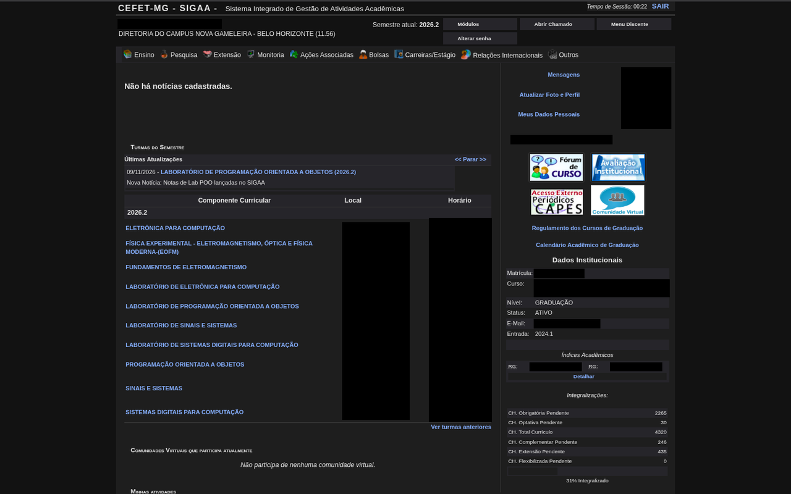
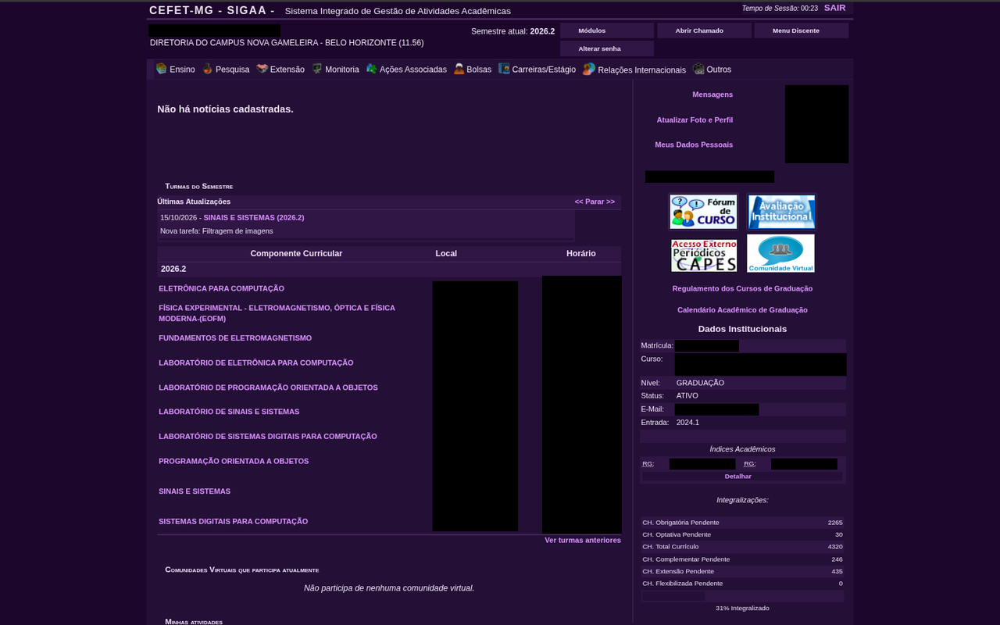
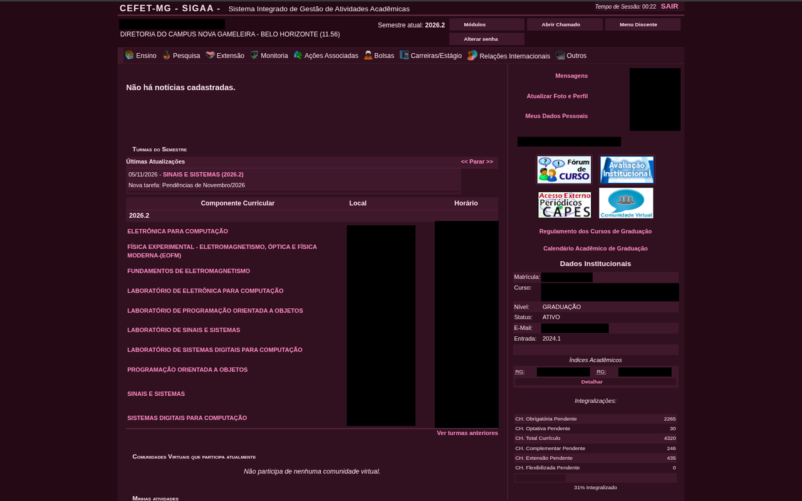
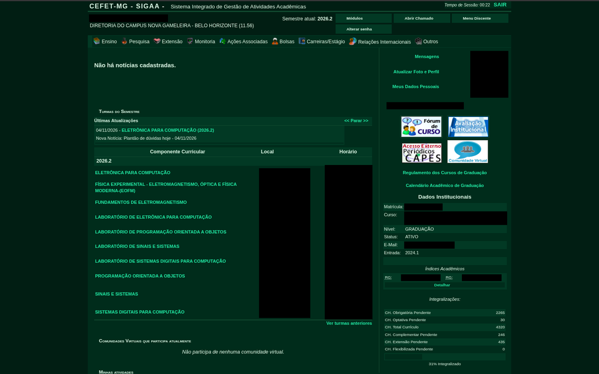
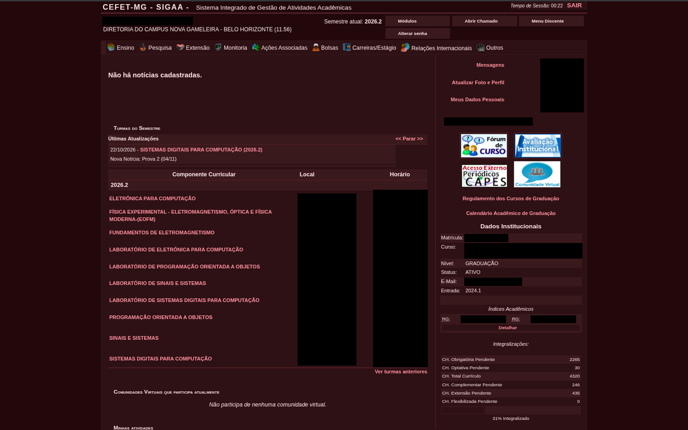

<div align="center">

# 🌙 SIGAA Dark Mode — CEFET-MG

**Tema escuro para o portal SIGAA do CEFET-MG, com 5 paletas.**
Feito de aluno para aluno, pra poupar a vista nas madrugadas de estudo.

[](https://chromewebstore.google.com/detail/sigaa-dark-mode-%E2%80%94-cefet-m/aijldljnalegppefehpcgkbcfblahnod)
[](https://chromewebstore.google.com/detail/sigaa-dark-mode-%E2%80%94-cefet-m/aijldljnalegppefehpcgkbcfblahnod)


> Projeto **não oficial**, sem qualquer vínculo com o CEFET-MG.

</div>

---

## Prévia

<table>
  <tr>
    <td align="center"><b>Dark</b></td>
    <td align="center"><b>Roxo</b></td>
    <td align="center"><b>Rosa</b></td>
    <td align="center"><b>Verde</b></td>
    <td align="center"><b>Vermelho</b></td>
  </tr>
  <tr>
    <td></td>
    <td></td>
    <td></td>
    <td></td>
    <td></td>
  </tr>
</table>

📸 Todas as screenshots do portal, uma por tema, em [`screenshots/`](screenshots/) no tamanho **1280×800**. Dados pessoais estão cobertos.

---

## Instalação

### Opção 1: Chrome Web Store (recomendado)

1. Acesse a [página da extensão na Chrome Web Store](https://chromewebstore.google.com/detail/sigaa-dark-mode-%E2%80%94-cefet-m/aijldljnalegppefehpcgkbcfblahnod).
2. Clique em **Usar no Chrome** (ou **Adicionar ao Chrome**).
3. Confirme em **Adicionar extensão**.
4. Acesse [sig.cefetmg.br/sigaa](https://sig.cefetmg.br/sigaa/) e pronto!

As atualizações chegam automaticamente.

### Opção 2: Instalação manual (modo desenvolvedor)

Útil se você quiser testar o código ou uma versão mais recente que ainda não chegou à loja.

1. Nesta página, clique no botão verde **Code** e depois em **Download ZIP**.
2. Extraia o `.zip` em uma pasta fixa do seu computador.
3. Abra o Chrome e acesse `chrome://extensions/`.
4. Ative o **Modo do desenvolvedor** (canto superior direito).
5. Clique em **Carregar sem compactação** (*Load unpacked*).
6. Selecione a pasta `sigaa-cefetmg-modoescuro-main/`.
7. Acesse [sig.cefetmg.br/sigaa](https://sig.cefetmg.br/sigaa/) e pronto!

> [!IMPORTANT]
> Selecione a pasta que contém o arquivo `manifest.json` **diretamente dentro dela**. Em alguns casos o Windows cria uma pasta dentro de outra com o mesmo nome ao extrair; se der erro de "arquivo de manifesto ausente", é isso.

> [!WARNING]
> Na instalação manual, não apague nem mova a pasta depois de instalar, senão o Chrome desativa a extensão. Também não há atualização automática: para atualizar, baixe o ZIP de novo, substitua os arquivos da pasta e clique no botão de recarregar da extensão em `chrome://extensions/`.

**Link direto:** <https://chromewebstore.google.com/detail/sigaa-dark-mode-%E2%80%94-cefet-m/aijldljnalegppefehpcgkbcfblahnod>

### Dica: fixe a extensão na barra

Clique no ícone de quebra-cabeça ao lado da barra de endereço e depois no alfinete ao lado de **SIGAA Dark Mode**. Assim o botão de ligar/desligar e a escolha de tema ficam sempre à mão.

---

## Como usar

- **Ligar/desligar:** clique no ícone da extensão e use o interruptor. A troca é
  na hora, sem recarregar a página.
- **Trocar de tema:** no mesmo popup, escolha uma das 5 paletas. Também na
  hora, e a escolha fica salva.

As duas preferências são guardadas separadamente (`chrome.storage`), então
desligar o modo escuro **não** faz você perder o tema escolhido.

---

## Temas

| Tema | Fundo | Destaque | Preview |
|:---|:---|:---|:---:|
| **Dark** | `#121212` | `#8ab4f8` | [ver](screenshots/portal_azul.png) |
| **Roxo** | `#170f2b` | `#c9a6ff` | [ver](screenshots/portal_roxo.png) |
| **Rosa** | `#200d15` | `#ff9ec4` | [ver](screenshots/portal_rosa.png) |
| **Verde** | `#0b1c13` | `#7ddba3` | [ver](screenshots/portal_verde.png) |
| **Vermelho** | `#1e0b0b` | `#ff9e9e` | [ver](screenshots/portal_vermelho.png) |

Cada tema é um bloco de variáveis CSS no começo do `style.css`. Como **todas** as
regras do tema usam `var(--sd-*)`, criar um tema novo é só colar mais um bloco —
veja o guia completo em [**`docs/CRIANDO-TEMAS.md`**](docs/CRIANDO-TEMAS.md).

---

## O que foi corrigido nesta versão (1.1.0)

Os principais bugs visuais da versão anterior estão resolvados:

- **O botão de ligar/desligar não funcionava** — o CSS era injetado sempre, então
  desativar não tinha efeito. Agora tudo é escopado em `html.sigaa-dark-mode`.
- **Faixas escuras atrás do texto** (nome, semestre, diretoria, menus, avisos) —
  os containers ficaram transparentes e o texto flutua sobre o fundo.
- **Barras de menu e dropdowns continuavam claros** — agora escuros, com os
  ícones invertidos por filtro.
- **Ícones com bloco branco/cinza** — os GIFs do SIGAA têm 46% dos pixels pretos
  puros; `invert()` puro estourava em branco. Ajustado com `brightness(0.85)`.
- **Texto invisível** (`h4`, `caption`, `span.data`, `legend`, etc.) e **fundos
  que escapavam** (`td` com `style="background:url(...)"`, gradientes, sprites).
- **Sprites de botão apagados** e **bordas coloridas no hover** dos menus.

> **Ainda são bem-vindos PRs de melhoria.** O SIGAA é um sistema legado, com
> centenas de telas e muita coisa gerada por JSF/Ajax. Novas telas e ajustes de
> contraste são sempre aceitos — veja [Como contribuir](#como-contribuir).

---

## Paleta de cores

| Variável | Código (tema Dark) | O que é |
|---|---|---|
| `--sd-page` | `#121212` | Fundo base da página |
| `--sd-surface` | `#1e1e1e` | Painéis e células de tabela |
| `--sd-raised` | `#26262a` | Superfície elevada (menu, botões) |
| `--sd-header` | `#1a2236` | Topo, hover de menu |
| `--sd-border` | `#333333` | Bordas |
| `--sd-text` | `#e0e0e0` | Texto principal |
| `--sd-text-dim` | `#a6a6b0` | Texto secundário |
| `--sd-link` | `#8ab4f8` | Links |

---

## Não funcionou?

- Recarregue a página do SIGAA (`Ctrl + F5`).
- Confira em `chrome://extensions/` se a extensão está **ativada**.
- Clique no ícone da extensão e veja se o modo escuro está **ligado**.
- Se acabou de trocar de tema e a cor não mudou, recarregue a página uma vez.
- Se ainda assim não resolver, tente limpar o cache do navegador.
- Continua com problema? [Abra uma Issue](../../issues) com um print.

---

## Privacidade e permissões

A extensão **não coleta, armazena nem envia nenhum dado seu**. Todo o código roda
localmente no seu navegador e é aberto para você conferir. Leia a
[Política de Privacidade](https://gist.github.com/hgiulliano/0c154e28da48c9751e743187ea09aebc).

| Permissão | Para que serve |
|---|---|
| `storage` | Salvar a preferência de liga/desliga e o tema escolhido |
| `sig.cefetmg.br/sigaa/*` | Aplicar o tema **somente** nas páginas do SIGAA, e permitir que o popup avise as abas abertas sobre a troca de tema |

> **São só essas duas.** A extensão não pede `tabs`, `scripting`, `activeTab`,
> `history`, `bookmarks`, `cookies` nem acesso a nenhum outro site. Sem
> permissão de host, não é possível avisar as abas abertas de que o tema mudou —
> e sem `storage` a escolha não sobreviveria a um F5.

---

## Arquitetura

```text
sigaa-cefetmg-modoescuro/
├── manifest.json        # Configuração MV3
├── style.css            # Tema escuro (injetado em document_start) + as 5 paletas
├── content.js           # Liga/desliga a classe e o data-sd-tema no <html>,
│                        #   + neutraliza estilos inline do JSF/Ajax
├── popup.html           # Interface: toggle + seletor de temas
├── popup.js             # Lógica do popup e persistência
├── background.js        # Service Worker (ativa na primeira instalação)
├── docs/
│   └── CRIANDO-TEMAS.md # Guia para adicionar paletas novas
├── screenshots/          # Screenshots 1280x800 de cada tema
└── icons/               # Ícones da extensão
```

**Como o toggle funciona:** o `style.css` é injetado pelo manifest em
`document_start`, mas *todas* as regras ficam dentro de `html.sigaa-dark-mode …`.
O `content.js` apenas coloca ou remove essa classe do `<html>`. Sem a classe a
página fica idêntica ao SIGAA original; com a classe, o tema escuro é aplicado —
e a troca surte efeito na hora, sem recarregar.

**Como o tema funciona:** cada paleta é um bloco
`html.sigaa-dark-mode[data-sd-tema="roxo"] { --sd-…: … }` no topo do CSS. O
`content.js` bota esse atributo no `<html>`. Como toggle e tema são mecanismos
independentes, desligar o modo escuro não perde a paleta escolhida.

**Filosofia visual:** texto flutuando direto sobre o fundo. Nenhum container
ganha fundo no escuro — no tema claro o SIGAA pinta faixas azuis/bege atrás do
nome, do semestre, dos menus e dos avisos, e no escuro essas faixas virariam
"barras pretas" atrás da escrita. Fundo existe só onde há componente de verdade:
células de tabela, campos de formulário, botões e a barra de módulos. A única
área que continua clara é o popup de "Módulos/Portais", cujos ícones são
`background-image` e não podem ser escurecidos sem desaparecer.

---

## Como contribuir

Encontrou um bug visual? Toda ajuda é bem-vinda.

- **Issue:** abra uma [Issue](../../issues) com o **print** e o **endereço da
  página** (sem dados pessoais).
- **Pull Request:** já sabe a correção? Envie um PR.
- **Quer uma paleta nova?** Siga o guia em [`docs/CRIANDO-TEMAS.md`](docs/CRIANDO-TEMAS.md)
  — são 3 passos e não exige saber CSS além das cores.

---

## Transparência

Este projeto foi desenvolvido com auxílio de Inteligência Artificial
([Claude](https://claude.ai)) para acelerar a criação do CSS.

O SIGAA é um sistema legado, com centenas de telas e estruturas dinâmicas, então
**podem existir bugs visuais ou textos com pouco contraste** em páginas
específicas. Os bugs conhecidos da versão anterior foram corrigidos, e melhorias
continuam sendo aceitas. Se achar algo, abra uma Issue. Ajuda muito!

---

## Licença

Distribuído sob a licença [MIT](LICENSE).

---

<div align="center">

[⬇️ Instalar pela Chrome Web Store](https://chromewebstore.google.com/detail/sigaa-dark-mode-%E2%80%94-cefet-m/aijldljnalegppefehpcgkbcfblahnod)
&nbsp;·&nbsp;
[⭐ Dar uma estrela no GitHub](../../stargazers)

---

<br><br>

Feito por [@hgiulliano](https://github.com/hgiulliano)

</div>
